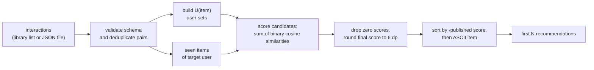

# local-recommender

Deterministic item-item collaborative recommendations using binary cosine
similarity. The product ships one pure Python function and a thin CLI; it has
no runtime dependencies, no training phase, no network calls and no database.

- **Spec version:** 0.1.4
- **Product version:** 0.1.0
- **Python:** 3.12
- **Platforms:** native Windows and Ubuntu (CI on `windows-latest` and
  `ubuntu-latest`)

## Problem and scope

Given a list of binary interactions (`user` saw `item`), recommend unseen
items to a target user. Two items are similar when they share users:
`Sim(i, j) = |U(i) ∩ U(j)| / sqrt(|U(i)| · |U(j)|)`. A candidate's score is the
sum of its similarities to every item the target user has already seen.

In scope:

- deterministic recommendations for a known user;
- exact, documented validation for malformed inputs;
- a library API and an equivalent JSON-file CLI;
- reproducible, fully offline tests.

Out of scope:

- popularity-based cold start or rating weights (unknown users get `[]`);
- personalisation from item content or metadata;
- persistence, servers, HTTP, accounts or credentials;
- resistance to physical disk failure or concurrent writers.

## Quickstart

Copyable, using the checked-in fixture:

```console
$ cat fixtures/example.json
[{"user":"u1","item":"a"},{"user":"u2","item":"a"},{"user":"u2","item":"b"}]
$ python app recommend fixtures/example.json --user u1
[{"item":"b","score":0.707107}]
$ python app --version
local-recommender 0.1.0
```

On POSIX the executable entrypoint is equivalent:

```console
$ ./app --version
local-recommender 0.1.0
```

The library is importable from the repository root without `pip install`:

```python
>>> from local_recommender import recommend
>>> interactions = [
...     {"user": "u1", "item": "a"},
...     {"user": "u2", "item": "a"},
...     {"user": "u2", "item": "b"},
... ]
>>> recommend(interactions, "u1")
[{'item': 'b', 'score': 0.707107}]
>>> recommend(interactions, "u1", limit=1)
[{'item': 'b', 'score': 0.707107}]
>>> recommend(interactions, "unknown-user")
[]
```

## API

`recommend(interactions, user, limit=5)`

| Argument | Contract |
| --- | --- |
| `interactions` | list of 0..10000 exact dicts `{"user": "u1", "item": "a"}`, keys exactly `user` and `item`; repeated pairs are deduplicated |
| `user` | ASCII identification string matching `[A-Za-z0-9_-]{1,32}` |
| `limit` | strict integer 1..100 (bool rejected), default 5 |

Returns a new list of `{"item": <str>, "score": <float>}` objects with at most
`limit` entries, sorted by descending score rounded to six decimal places
(half-even), then by ascending ASCII item. Zero-score candidates are omitted.
The function does not mutate its arguments, perform I/O or keep global caches.
Invalid input raises `ValueError`.

## CLI

```text
python app recommend FILE --user USER [--limit N]
python app --version
python app --help
```

- `FILE` is UTF-8 JSON holding an array of interaction objects, at most
  1 MiB (1048576 bytes, inclusive, measured before parsing).
- Success prints exactly one line of JSON on stdout and nothing on stderr.
- Validation and JSON/schema errors exit `2`; file I/O errors exit `3`. Errors
  print one `error:` line on stderr with no traceback and no stdout data.
- `--version` prints exactly `local-recommender 0.1.0\n` and exits `0`.
- `app.cmd` is the Windows wrapper and propagates arguments and the exit code.

## Formula and output decisions

1. `U(i)` is the set of distinct users of item `i`, after deduplicating exact
   `(user, item)` pairs.
2. Items the target user has seen are not candidates.
3. Candidate score is `Σ Sim(i, j)` over the target user's seen items — a sum,
   not an average, with no rounding of individual terms.
4. Scores are finite 64-bit floats; the final score is rounded to six decimals
   with half-even rounding, and `-0.0` is never emitted.
5. Sorting uses the **published** rounded score, then ASCII item, so ties do not
   depend on insignificant floating-point differences or input order.
6. Duplicate pairs have no effect on cardinality or weight; no user-supplied
   weights are accepted.

## Limits

| Limit | Value |
| --- | --- |
| Records per call/file | 10000 (inclusive) |
| Distinct users | 1000 (inclusive) |
| Distinct items | 1000 (inclusive) |
| Recommendation `limit` | 1..100 (inclusive) |
| Input file size | 1048576 bytes (inclusive) |

Identifiers are ASCII `[A-Za-z0-9_-]{1,32}`. JSON must be UTF-8 without a BOM;
duplicate keys, `NaN`/`Infinity` and extra fields are rejected.

## Architecture



The package has no persistence layer: there is no state to write, so the
atomic temporary-file protocol applies only conceptually to callers that
choose to persist CLI output themselves. The CLI reads its input file
completely and validates it before emitting any data.

## Tests and lint

One documented command runs the public black-box suite:

```console
$ python -m pytest tests -q
```

Lint and format checks:

```console
$ ruff check .
$ ruff format --check .
```

Test and lint dependencies are pinned in `requirements-dev.txt` (and in the
`dev` extra of `pyproject.toml`). No dependency is installed during tests.

The public tests in `tests/` are traceable to acceptance criteria `AC-1` …
`AC-12` by test name and docstring. The CLI is exercised through subprocesses
using `sys.executable`; libraries are used only through
`local_recommender.recommend`; no private module is imported by the tests.

## Continuous integration

`.github/workflows/ci.yml` runs lint and tests on `ubuntu-latest` and
`windows-latest` with Python 3.12 and `PYTHONUTF8=1` on every push and pull
request. A local Linux run does not establish that Windows is green; only CI
can. This repository does not claim a CI verdict that has not been observed.

## How this was built

This section records authorship and the observed model, without claiming
evidence that does not exist.

- **Specification:** issue #1, spec v0.1.4, authored by the repository owner
  (Forgeline Labs). The spec defines the contract, not the implementation.
- **Implementation and public tests:** produced by an AI coding agent in an
  automated harness session. The model identifier observed in that session's
  metadata was `deepseek-flash`; the originally requested model is not
  independently verifiable from this repository, so it is recorded as unknown
  in `docs/RUNS.md`.
- **Independence:** the public tests were written by the same agent in the same
  session as the implementation, based on the spec. They are therefore **not**
  an independent black-box audit. The spec calls for hidden tests authored by
  an independent agent of a different model family; those, and the spec×test
  audit, live outside this clone and are not claimed here.
- **Human participation:** no human editing was observed in the implementation
  session. Maintainer corrections, review and merge are recorded by the
  maintainer; this document does not invent them.
- **Stages:** specification, public tests and implementation are distinct
  artefacts; the implementation was written after the public tests and was not
  copied from hidden tests.
- **Results:** see `docs/RUNS.md` for the per-run record. Nothing in this
  repository asserts a future verdict or an external verification that has not
  happened.

## Delivery contract

Version, tag, release, issue comments and publication are the maintainer's
responsibility after merge. This implementation creates no tag, release,
account or external submission.
